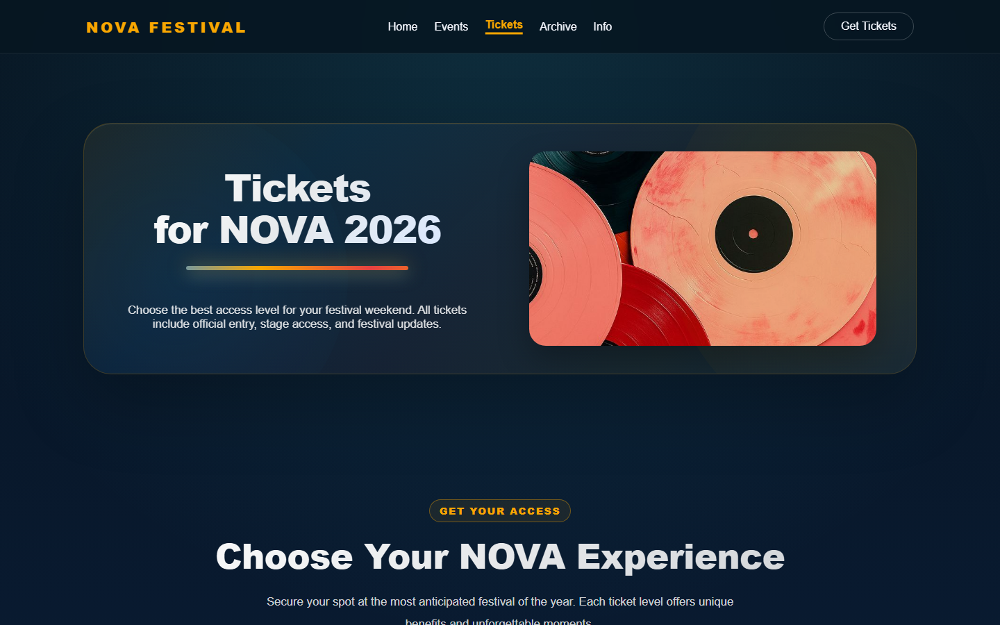
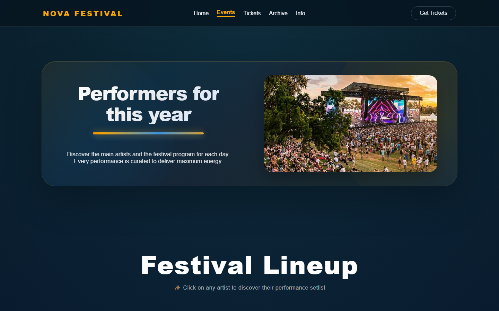
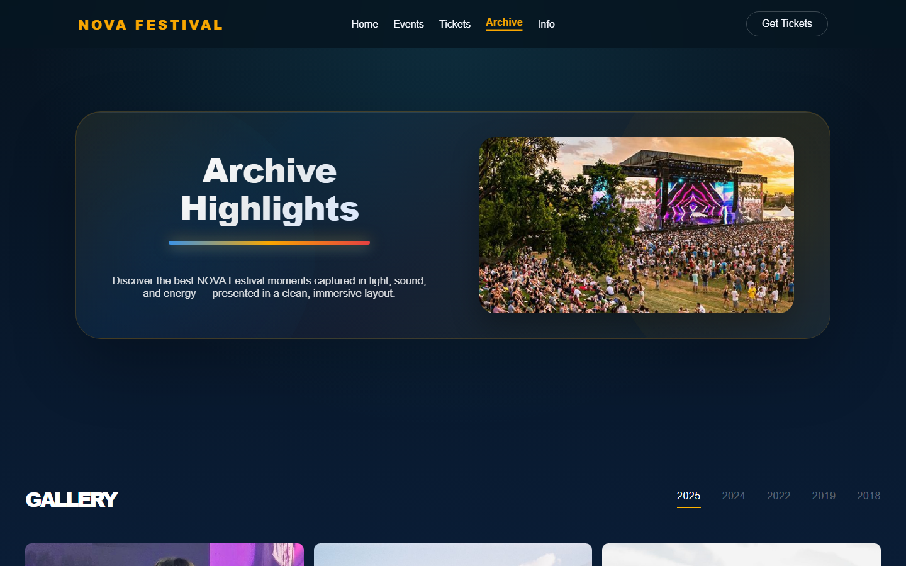
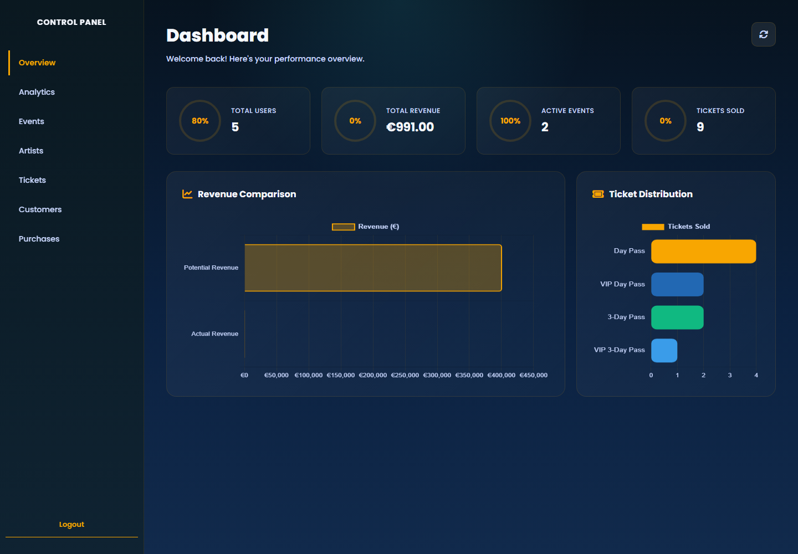

# NOVA Festival 🎶

A full-stack ticketing website for a fictional 3-day music festival. Visitors can browse events and artists, create an account, buy tickets and download e-tickets. Administrators manage the whole festival from a dashboard with sales analytics.

Built with **PHP**, **MySQL**, **HTML/CSS** and **vanilla JavaScript**, without any framework.


## Features

### For visitors
- Landing page, event line-up, ticket tiers, photo archive of past editions and an info/FAQ page
- Registration and login in a modal, with validation and AJAX requests
- User profile: edit contact details, add a payment method, see purchase history
- Ticket purchase with a live availability check
- Download an e-ticket once the admin has confirmed the purchase

### For administrators
- Dashboard with KPIs (users, revenue, events, tickets sold) and charts (Chart.js)
- CRUD for **events**, **artists** (many-to-many line-ups) and **ticket types**
- Purchase management: confirm orders, or cancel and refund them (tickets go back to stock)
- Customer list with spending statistics and a payment report

## Technical highlights
- **Role-based access control**: users and roles are separate tables. Every admin page and API endpoint checks the role on the server ([`Backend/config/auth.php`](Backend/config/auth.php)).
- **Secure authentication**: bcrypt password hashing, `session_regenerate_id()` on login, and a generic error message so attackers cannot tell which emails are registered.
- **SQL injection protection**: all queries that take user input use prepared statements.
- **XSS protection**: database values are escaped with `htmlspecialchars()` before they are rendered.
- **Transactions**: purchases, refunds and registration run inside MySQL transactions. Tickets are reserved with an atomic `UPDATE ... WHERE availability >= ?`, so two buyers at the same moment can never oversell a tier.
- **Relational schema** with foreign keys and many-to-many relations: see [`database.sql`](database.sql).

## Screenshots

| Tickets | Events |
|---|---|
|  |  |

| Archive | Admin dashboard |
|---|---|
|  |  |

## Database

```
users ──< user_roles >── roles
users ──< purchases >── ticket_types
purchases ──< payments
purchases ──  e_tickets
events ──< event_artists >── artists
```

## Getting started

**Requirements:** [XAMPP](https://www.apachefriends.org/) (or any PHP 8.1+ and MySQL/MariaDB setup).

1. Copy the project folder into `C:\xampp\htdocs\` (for example `C:\xampp\htdocs\novafestival`).
2. Start **Apache** and **MySQL** from the XAMPP Control Panel.
3. Open <http://localhost/phpmyadmin>, go to **Import** and import [`database.sql`](database.sql).
   This creates the `festival` database with demo data.
4. Visit <http://localhost/novafestival>.

The connection uses the XAMPP defaults (`localhost`, user `root`, no password, database `festival`).
To use different credentials, set the `DB_HOST`, `DB_PORT`, `DB_USER`, `DB_PASS` and `DB_NAME` environment variables ([`Backend/config/db.php`](Backend/config/db.php)).

### Demo accounts

| Role  | Email                    | Password   |
|-------|--------------------------|------------|
| Admin | `admin@novafestival.com` | `admin123` |
| User  | `user@novafestival.com`  | `user1234` |

> Payments are **simulated**: no real payment provider is used and no card data is stored.

## Project structure

```
├── index.php            # Landing page
├── events.php           # Line-up and events
├── tickets.php          # Ticket tiers
├── gallery.php          # Archive of past editions
├── info.php             # Info, FAQ and contact
├── profile.php          # User profile and purchases
├── admin.php            # Admin dashboard
├── header.php / footer.php
├── Backend/
│   ├── config/          # Database connection and auth helpers
│   └── api/             # JSON endpoints (auth, purchases, CRUD)
│       └── admin/       # Admin-only endpoints (refunds, e-tickets, reports)
├── css/ , style.css
├── images/
└── database.sql         # Schema and demo data
```

## Author

**Semine Muharremi** · [GitHub](https://github.com/SemineMuharremi)
